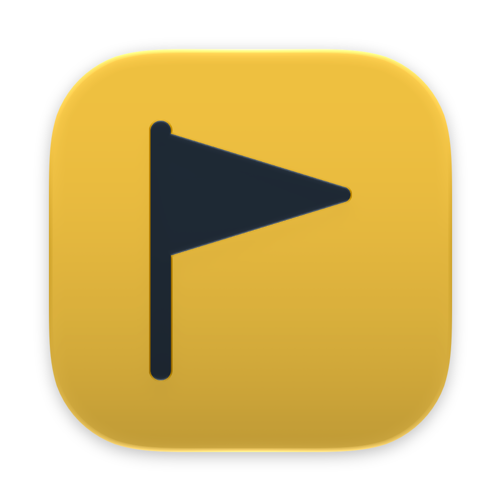
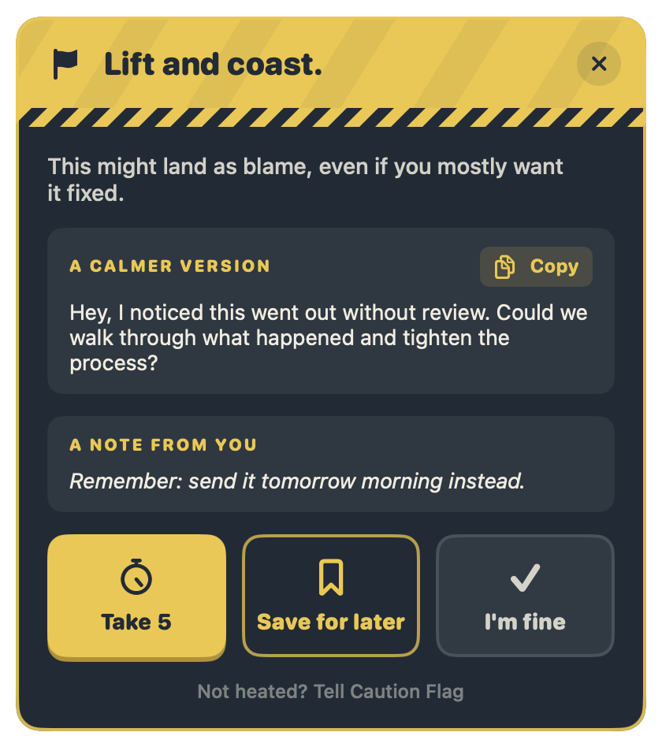

<p align="center"></p>

<h1 align="center">Caution Flag</h1>

<p align="center">A macOS menu bar app that notices when a chat draft is running hot and raises a flag before you send it.<br>All analysis is local. Nothing you type leaves your Mac.</p>

<p align="center"></p>

It watches the message box in Slack and other apps you choose, rates the tone as you type, and steps in when a draft is heated.

- **Warm (score 4–6):** the menu bar flag turns yellow and a small pill appears above the message box. It fades on its own.
- **Hot (7+):** the flag turns red, the screen dims around your message box, and a caution-tape panel shows why, a calmer rewrite with a Copy button, your own note to yourself, and three choices: **Take 5** (a breathing timer), **Save for later**, or **I'm fine**. It appears next to the message box, or centered on the screen if you prefer (Settings).
- **Quick runs:** several short messages sent back to back are read together with the next draft, since a run of calm-looking one-liners can add up to a defensive reply. The nudge offers to gather them into one message.
- **Not heated:** if a nudge misreads a message, tap **Not heated** to keep it for later tuning. It doesn't change how the app behaves.

When Caution Flag is watching, the menu bar pennant is green; it turns yellow or red for heated drafts, like racing flags. A plain silhouette means it's off (snoozed, in quiet hours, or watching no apps).

Requires macOS 15+. Apple's on-device model needs macOS 26+ with Apple Intelligence on; otherwise use Ollama.

## Install

```sh
brew install --cask taylorbird/caution-flag/caution-flag
```

The app then keeps itself up to date (Sparkle): it checks once a day and installs signed updates on its next relaunch. **Check for Updates…** is in the menu bar menu. Release zips are signed with Developer ID, notarized, and attached to the GitHub releases of the tap ([taylorbird/homebrew-caution-flag](https://github.com/taylorbird/homebrew-caution-flag)).

## Build and run

```sh
brew install xcodegen          # once
scripts/build.sh --run         # builds Release, installs to /Applications/Caution Flag.app, launches it
```

The project is generated from `project.yml`, so don't edit `CautionFlag.xcodeproj` by hand. Every build is signed with the Developer ID Application identity (team `UFCDGSKCXB`) with the hardened runtime, so the Accessibility grant survives rebuilds and releases can be notarized. With ad-hoc signing, macOS would forget the grant every build.

Always run the app from `/Applications`: on macOS 27, Bartender can't see the menu bar item of an app run from anywhere else. `build.sh` installs there.

The build number is the git commit count. The icon is an Icon Composer package (`assets/icon/AppIcon.icon`) whose layers come from `swift scripts/render-icon.swift`; the source geometry is `assets/icon/caution-flag.svg`.

## Release

```sh
scripts/release.sh 0.2.0 --dry-run   # build, notarize, staple, zip; publishes nothing
scripts/release.sh 0.2.0             # on main, clean tree: also tags, pushes, and updates the tap
```

The full run sets the version in `project.yml` and commits it. It notarizes with the `notary` keychain profile and checks that Gatekeeper accepts the stapled app. Then it tags `v<version>`, creates a GitHub release with the zip on the tap repo, bumps the cask's version and sha256, and adds the release to the tap's Sparkle feed (`appcast.xml`), signed with the EdDSA key in the login Keychain. It needs `gh` logged in as `taylorbird`, the tap cloned at `../homebrew-caution-flag`, and that Keychain key. Back up the key with Sparkle's `generate_keys -x <file>`: without it, installed copies can't verify future updates.

Tests and the sample harness live in the core package:

```sh
swift test --package-path Packages/CooldownCore
swift run  --package-path Packages/CooldownCore cooldown-harness            # heuristics only
swift run  --package-path Packages/CooldownCore cooldown-harness --apple    # + Apple model
swift run  --package-path Packages/CooldownCore cooldown-harness --ollama --model qwen2.5:3b
swift run  --package-path Packages/CooldownCore cooldown-harness --apple --text "per my last message…"
```

To check the panels without Slack: `"/Applications/Caution Flag.app/Contents/MacOS/Caution Flag" -demo hot` (or `warm`, `breathing`, `onboarding`, `settings`).

## Permissions

Caution Flag needs **Accessibility** access so it can read the focused text field in apps you've chosen. The first launch opens a setup guide:

1. Click **Open Accessibility Settings**.
2. Find **Caution Flag** in System Settings › Privacy & Security › Accessibility and switch it on.
3. The guide's checkmark turns green within a second.

If it's switched on but not detected (usually after moving or re-signing the app), remove it with **–**, then add `/Applications/Caution Flag.app` again.

Slack is an Electron app, so Caution Flag sets `AXManualAccessibility` on it to make Chromium expose its accessibility tree. To find the composer, it tries the app's focused element, then the system-wide one, then descendants of a focused wrapper group, then the last composer it found. As a last resort, and at most once every 2 s, it does a bounded search of the window. Password and secure fields are skipped.

"Clear it from the message box" (offered only after you save a draft) first tries an Accessibility write. If Slack ignores that, it sends ⌘A then Delete to Slack.

## Tone models

Settings › Model offers **Automatic** (Apple, then Ollama), **Apple**, **Ollama**, or **Quick checks only**.

Quick checks always run first: all caps, `!!`/`?!`, profanity and insults, "always"/"never", blame phrases ("how many times", "your fault"), passive-aggressive phrases ("per my last message", "as I already said"), and sarcasm markers. They lift the model's score but never lower it. A very short draft (≤30 characters) with no signals skips the model.

The model is asked for JSON with `heat` 0–10, `category` and a one-sentence `reason`. Apple's model uses guided generation (`@Generable`) with a prewarmed session. Ollama uses its structured-output `format` schema, and the parser tolerates code fences, prose, stringified numbers and odd category spellings. The calmer rewrite is a separate, plain-text call made only when the red panel opens, and it fills in place.

Timing: the text field is checked every 0.25 s, and drafts are rated while you type. Quick checks are instant. One model score is always in flight, and the newest text is scored as soon as it finishes, so a heated phrase usually brings up the panel about 1.5 s later without waiting for a pause. The model is warmed up when a new draft starts. A rewrite follows in about a second. If Apple's safety layer declines the text, it's treated as at least warm.

Context: once two drafts in 20 minutes have run warm or hotter, scores get +1 until things settle.

### Setting up Ollama

```sh
brew install ollama
ollama serve &                 # or launch the Ollama app
ollama pull llama3.2:3b        # or qwen2.5:3b
```

Then go to Settings › Model › Ollama and click **Test connection**. The first request after a restart takes several seconds while the model loads; Caution Flag asks Ollama to keep it warm for 30 minutes.

## Privacy model

- Text is read only from apps you've switched on, and only while that app is in front.
- Analysis runs on-device: Apple's model, or Ollama at a **loopback** address. `LoopbackGuard` rejects any other host in code, and that check is unit-tested.
- Draft text lives in memory only. It isn't logged, persisted or sent anywhere. Logs (`log stream --predicate 'subsystem == "com.tbird.cautionflag"'`) contain scores and levels only.
- Text reaches disk only when you click a button, and both files are mode 600:
  - **Save draft for later** writes that draft to `~/Library/Application Support/Caution Flag/drafts.json`. Delete drafts from the menu bar › Saved Drafts.
  - **Not heated** writes the flagged text and its scores to `~/Library/Application Support/Caution Flag/misreads.json`, for reviewing misreads when tuning. The app never changes its behavior because of these. Delete them from the menu bar › Not Heated Reports.
- **Quick runs:** with "Notice quick runs of messages" on (Settings › General), the last few short messages you sent are kept in memory for up to three minutes, and for one minute after your last send, so the next draft can be read together with them. They are never written to disk or logged.
- Settings (sensitivity, watched apps, quiet hours, your personal note) live in UserDefaults.

## Layout

```
Packages/CooldownCore/    pure logic, unit-tested
  HeuristicScorer         cheap pre-checks
  ToneResponseParser      lenient model-JSON parsing
  ScoreCombiner           model + heuristics + sensitivity + recent context → level
  ToneAnalyzer            protocol; FoundationModelsToneAnalyzer, OllamaToneAnalyzer
  SampleMessages          calm / heated / subtle fixtures (tests + harness)
App/Sources/
  Capture/                TextCaptureService (AX polling every 250 ms on a background queue; focused app read via AX)
  Analysis/               DraftCoordinator (continuous scoring, one model call in flight, instant heuristic nudge), AnalyzerProvider
  Interventions/          InterventionController, non-activating NSPanels, pill/panel/breathing views, DimmingWindow, PanelMotion
  App/                    AppController, StatusItemController, UpdateController (Sparkle)
  Settings/               SettingsStore, DraftStore
  Windows/                onboarding, settings, saved drafts
```

## Roadmap

Built (MVP): Slack capture, Apple + Ollama analysis, heuristics, warm/hot nudges, rewrites, Take 5, saved drafts, sensitivity, watched apps, quiet hours, snooze, personal note, launch at login, onboarding.

Next: cooling-off mode (a scoped event tap on Return in the watched app, with a 60-second wait or deliberate confirmation, easy to toggle off), and the opt-in local weekly stats (nudges and pauses; scores and timestamps only).
